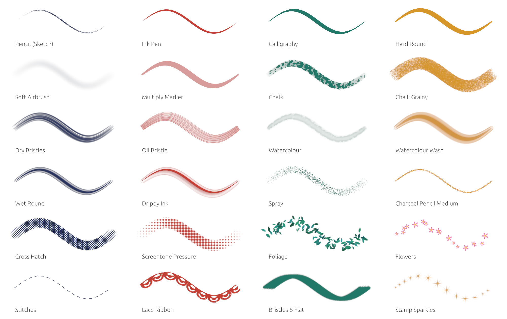

# Rusty Painter

[](https://github.com/Vectra777/rusty-painter/actions/workflows/ci.yml)
[](https://github.com/Vectra777/rusty-painter/releases)
[](LICENSE)

A painting app built with Rust, egui and wgpu, for Linux, Windows, Android and iPad. The canvas is split into tiles, brushes paint on their own thread, and the UI stays out of the way.


**📖 Documentation: <https://vectra777.github.io/rusty-painter/>** (user guide, developer guide and API reference; the source is in [`docs/`](docs/)).

## Features
- **Brushes**: soft, pixel, bristle, image-tip and Krita-style engines (spray, chalk, particle…), dynamics and input curves, paper textures, colour mixing, wet paint and impasto; brushes import from GIMP, Photoshop, Krita, MyPaint, Clip Studio and ibisPaint (its brush QR codes).
- **Tablets**: pressure, tilt and the eraser on Windows, Linux (X11 and Wayland), Android and iPad (Apple Pencil Pro barrel roll included).
- **Layers**: folders, masks, clipping, adjustment, fill, vector, text and live GLSL shader layers.
- **Selections, transforms and filters**: magic wand to magnetic lasso, perspective, distort, liquify and puppet warp, over 30 filters previewed live, content-aware fill.
- **Animation**: frame by frame with onion skins, Spine/DragonBones/Lottie rigs and rigs made here, video import, time-lapse.
- **Colour**: 8, 16-bit or float documents, ICC profiles and soft proofing.
- **Files**: `.rpainter` projects (OpenRaster, with the whole undo history), PNG, JPEG, TIFF, WebP, PSD and SVG export; `.psd`, `.kra` and `.clip` open with their layers.


A few of the built-in brushes:



## Install
Download a release from the [releases page](https://github.com/Vectra777/rusty-painter/releases) (Linux tarball or Flatpak, Windows zip, Android APK), or build it (stable Rust 1.88 or newer; on Windows, the MSVC toolchain):

```bash
cargo run --release
```

See [Install](https://vectra777.github.io/rusty-painter/user/install.html) and [Building](https://vectra777.github.io/rusty-painter/dev/building.html) for every platform.

## Docs locally
```bash
cargo install mdbook
mdbook serve docs --open
```

## License
GPL-3.0-only: see [LICENSE](LICENSE).

The UI's icons are [Phosphor Icons](https://phosphoricons.com) (v2.0.8), MIT: see
[assets/icons/phosphor/LICENSE](assets/icons/phosphor/LICENSE).

## Contributing
The project is early-stage and focused on performance experiments. If you have ideas for improving brush quality, tiling performance, or UI/UX, feel free to open an issue or directly contact me. Tests and benchmarks are especially welcome.
