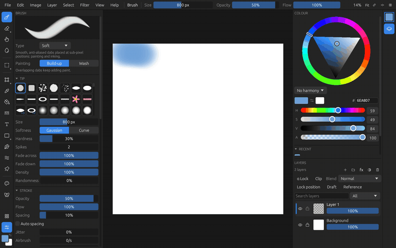

# Rusty Painter

Rusty Painter is a painting app written in Rust on egui and wgpu. Its canvas is split into tiles, brushes are painted on a separate thread, and it runs on Linux, Windows, Android and iPad.

- **[User guide](user/install.md)**: installing, then every tool and menu: brushes, layers, selections, filters, animation, files.
- **[Developer guide](dev/building.md)**: building for each platform, how the code is laid out, where a change goes, tests, benchmarks and the [API reference](dev/api.md).

Rusty Painter is free software under the GPL-3.0. Its source, issues and releases are on [GitHub](https://github.com/Vectra777/rusty-painter).
