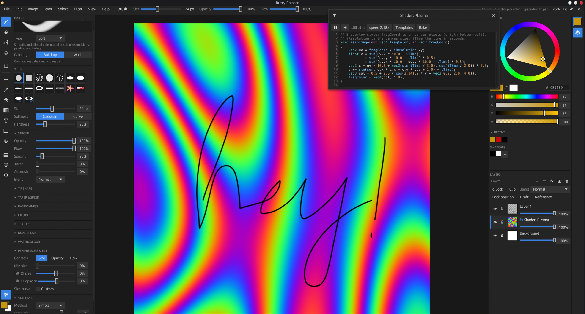

# Getting started

The canvas gets the screen: everything else is one thin bar and two rails, with panels that slide out when you want them.

- **Top bar**: the menus (File, Edit, Image, Layer, Select, Filter, View, Help), the active tool's options, and zoom / fit / ruler / flip on the right. In touch mode: the menu sheet, finger painting, undo and redo.
- **Tool strip** (left edge): the tools; its bottom button opens the brush settings panel.
- **Right rail**: the brush colour (opens the colour panel) and layers.
- **Notices**: messages (export done, errors) appear briefly over the canvas's corner.

`Tab` hides or shows every panel. On a phone-sized window panels float over the canvas, one at a time, and a tap on the canvas closes them.

## A first painting

1. **File → New** (`Ctrl+N`) picks the canvas size and [colour depth](colour.md#colour-depth). The default canvas is 4000×4000.
2. `B` picks the brush. Choose a preset from the presets panel; your current colour is kept.
3. Paint with the left button or the pen. `[` and `]` change the size, `E` swaps to the eraser.
4. Move around: `Space` + drag or right drag pans, the wheel zooms, middle drag rotates, `Ctrl+0` fits the canvas to the window. On a touch screen two fingers pan, pinch and twist.
5. **File → Save** (`Ctrl+S`) keeps the work as a `.rpainter` project; **File → Export** (`Ctrl+E`) writes a PNG, JPEG and [more](files.md).

## History

Edit → History (`Ctrl+H`) lists every step by what it did (the tool, filter or command); click one to go back to it, or forward again. There is one undo history for the whole document (pixels, selections, transforms, layer add/remove/reorder/merge, canvas resizes; all of it kept in saved files), undone in the order things were done whichever layer is selected.

## Tabs

Several documents can be open at once. Opening or creating one while the shown document has work in it opens it in a new tab over the canvas; `Ctrl+Tab` / `Ctrl+Shift+Tab` switch, `Ctrl+W` (or a middle click) closes, asking first about unsaved work. Each tab keeps its own history, view and selection, and its own autosave.

## Autosave

Unsaved work is kept once the app is idle, and offered back after a crash or a quit without saving.

## The Image menu

Canvas size (with an anchor), image size (smooth or hard pixels), crop to selection, rotate and flip the whole document, each one undo step.

## Settings

Settings has the keyboard layout (QWERTY, AZERTY or QWERTZ, detected or set), pen calibration, masked brush (fast), high-quality zoom out (slower), and the brush thread count.
